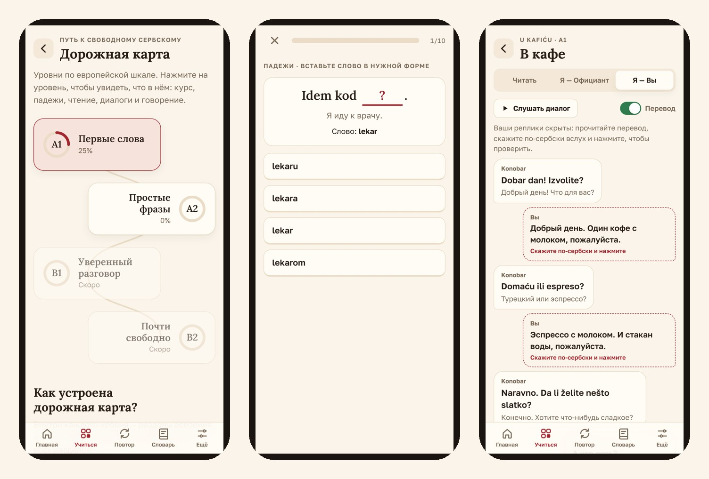
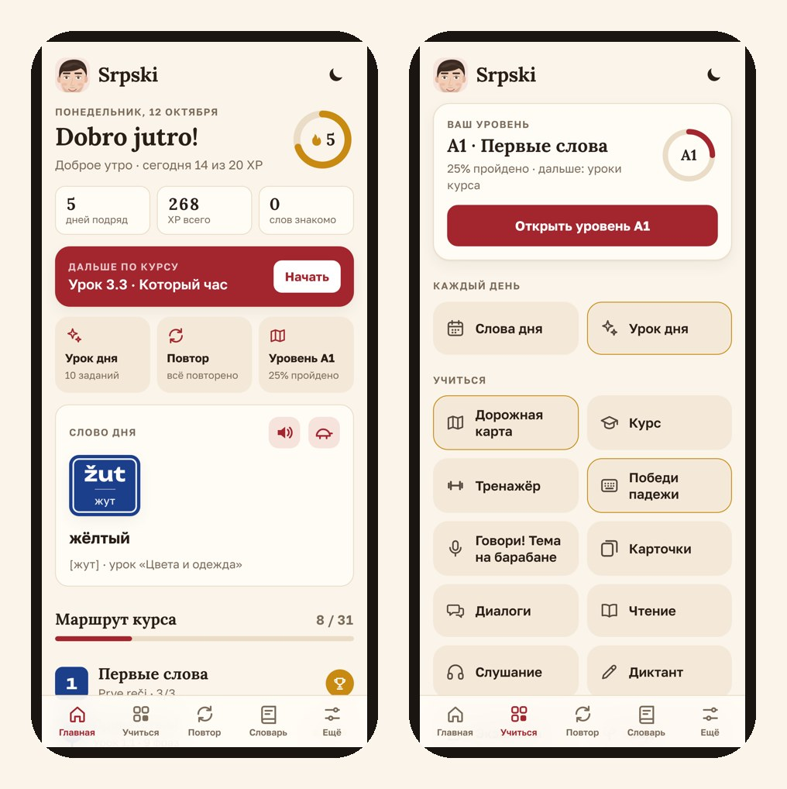

<!--
Статья для vc.ru (раздел «Личный опыт» или «Образование»). Подойдёт и для Пикабу, Дзена, Facebook-групп релокантов.
Перед публикацией: заменить [в квадратных скобках], загрузить картинки из promo/articles/img/.
-->

# Сербский для русских: 7 ловушек, на которых спотыкается каждый после переезда, и бесплатное приложение, которое я сделал для себя

[Я переехал в Сербию в … году.] Первые месяцы казалось, что сербский — это почти русский, только смешнее: «hleb», «voda», «pivo», «brat». А потом начались ловушки. Собрал главные — сохраните, если живёте здесь или собираетесь.

## 1. «Sutra» — это не утро

Sutra — **завтра**. «Vidimo se sutra» — «увидимся завтра», а не утром. Утро — jutro.

## 2. «Pravo» — это не право

Pravo — **прямо**. Таксист, который говорит «pravo, pa levo», не про законы: «прямо, потом налево». А «desno» — направо.

## 3. «Stolica» — не столица

Stolica — **стул**. Столица — glavni grad. А «divan» — не диван, а **чудесный**: «Divan dan!» — «Чудесный день!»

## 4. «Ponos» — гордость, не то, что вы подумали

Тут без комментариев. Ponos — **гордость**. Произносите смело.

## 5. Две азбуки — и обе официальные

Вывески, меню и чеки — чаще на латинице, документы и госуслуги — на кириллице. Хорошая новость: одна буква — один звук, и шесть новых букв (Ђ Ј Љ Њ Ћ Џ) учатся за вечер.

## 6. Падежи почти как в русском — но не совсем

«Zovem mamu» — звоню маме, но падеж **винительный**: zvati koga? «Idem kod lekara» — иду к врачу, и после «kod» — **родительный**. А ещё есть звательный: «Brate!», «Sestro!», «Marko!» — сербы им пользуются постоянно.

## 7. «Polako» — главное сербское слово

Polako — **спокойно, не спеши**. Его говорят в очереди, за рулём, в МУПе и на свидании. Выучите первым — и жизнь в Сербии станет проще.

---

## Почему я сделал своё приложение

Я искал, как быстро выучить бытовой сербский именно русскоязычному: кафе, рынок, такси, квартира, документы, врач. Учебники — про «мальчик читает книгу», популярные приложения — не про русских и не про жизнь в Сербии. Поэтому [в свободное время] я сделал **Srpski** — для себя, а потом выложил для всех.

**Что внутри:**

- **31 урок и 318 фраз «для жизни»**: от «Zdravo» до «Treba mi potvrda» (мне нужна справка). У каждого слова — озвучка и подсказка, как читать по-русски.
- **Повтор в нужный момент**: слово возвращается через 1, 2, 4, 8 дней — так оно не забывается.
- **Победи падежи**: 40 фраз из жизни вместо таблиц.
- **Диалоги по ролям**: кафе, рынок, такси, аптека, МУП. Можно играть свою роль — реплики скрыты, говорите вслух.
- **Говори! Тема на барабане**: колесо выбирает тему, у вас минута, чтобы рассказать. Можно записать себя.
- **Чтение**: короткие истории, нажали на фразу — услышали и увидели перевод.
- **Урок дня на 5 минут**, дорожная карта A1 → A2, и сад, который растёт, пока вы учитесь.

Всё **бесплатно, без регистрации и рекламы**. Работает без интернета.

## Как поставить на iPhone (и не потерять прогресс)

1. Откройте **[zdravo.srpski.workers.dev](https://zdravo.srpski.workers.dev/)** в Safari.
2. Нажмите «Поделиться» → «На экран „Домой“».
3. Заходите с иконки: прогресс сохранится, приложение работает офлайн.

На Android: меню Chrome → «Добавить на главный экран».

---

Новые слова, ложные друзья и сленг каждый день — в Telegram [@srpski_coach](https://t.me/srpski_coach) и Instagram [@srpski_coach](https://www.instagram.com/srpski_coach/).

А какое сербское слово удивило вас больше всего? Пишите в комментариях — добавлю лучшие в приложение. Polako i srećno! (Спокойно и удачи!)
